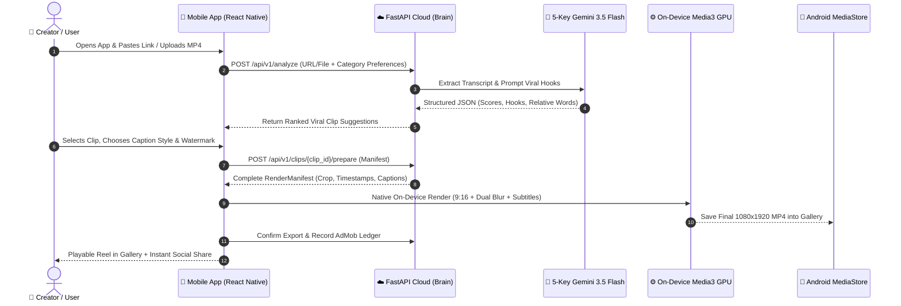
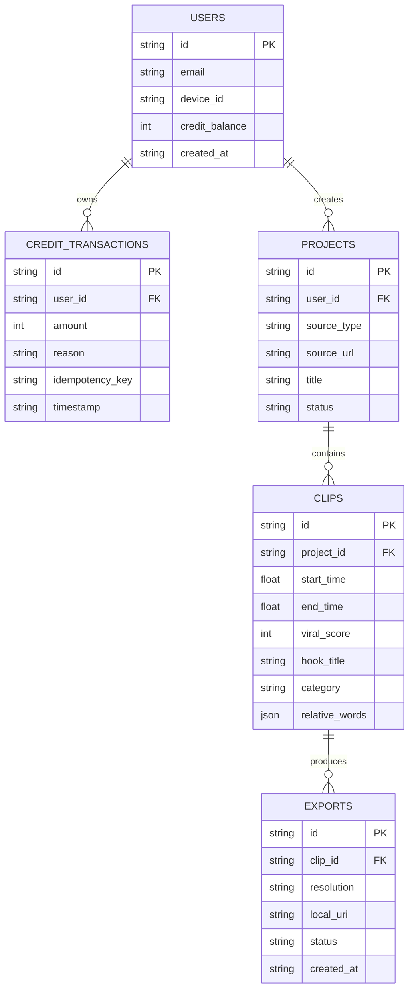

# 🚀 AI Viral Shorts Mobile SaaS — Complete Architecture & Phased Roadmap

> **Target App:** ClipSnap AI / ai.pro  
> **Core Architecture:** Edge-Cloud Hybrid (FastAPI + 5-Key Gemini 3.5 Flash Brain + On-Device Android Media3 GPU Renderer)  
> **Release Target:** Google Play Store (Production AAB Release)  

---

## 1. End-to-End User Journey & Architecture

The application is structured to deliver an instant, zero-server-cost video creation experience by offloading heavy video rendering to the user's phone GPU, while the cloud acts strictly as the high-speed AI Intelligence Brain.

---

## 2. The 10 Core Application Modules & Phasing Matrix

To ensure rapid delivery without getting overwhelmed, features are divided into three deliberate release phases:
* **Phase 1 (MVP v1.0 - Current Release):** Fast, fully functioning core loop from input to rendered 9:16 video on device.
* **Phase 2 (Growth v1.5):** Cloud user accounts, persistent projects, direct OCI storage, and multi-category filters.
* **Phase 3 (Scale v2.0):** Active face tracking, automated video reframing, and forced-alignment karaoke subtitles.

| Module | Core Functionality | Phase 1 (MVP v1.0) | Phase 2 (Growth v1.5) | Phase 3 (Scale v2.0) |
| :--- | :--- | :---: | :---: | :---: |
| **M1: Auth & Profile** | User identity, sign-in, account settings | Guest / Device ID Mode | Email + Google Sign-In | Social Sync & Team Profiles |
| **M2: Home Dashboard** | Main hub, quick start, bottom tabs | Single Home Dashboard | 5 Bottom Tabs (Home, Projects, Create, Exports, Profile) | Personalized AI Templates Feed |
| **M3: Video Ingestion** | Ingest media (YouTube links & MP4s) | YouTube URL + Local File Picker | Direct OCI Presigned Upload URLs | Multi-format (MOV, MKV) + Cloud Drive |
| **M4: AI Analysis Engine** | Transcript extraction, hook detection | Gemini 3.5 Flash + 5-Key Pool | User Category Selection (Funny, Educational, etc.) | Custom AI Prompt Personas |
| **M5: Clip Selection** | Review suggested clips with scores | Swipeable Viral Cards (Scores 1–100) | Multi-select List + Duration Filters | Multi-clip Batch Queue |
| **M6: Editing Studio** | Captions, layouts, styling, branding | 9:16 Dual Blur + Hype Yellow / Clean Minimal | Trim Sliders + Custom Font Colors | Active Speaker Face Centering |
| **M7: Render Engine** | High-performance video creation | Android Media3 On-Device Renderer | Hardware Acceleration Profiler | 4K 60fps & Custom Bitrate Presets |
| **M8: Export History** | View and replay exported shorts | Direct Gallery Save | Local SQLite Export History & Re-share | Cloud Backup of Project Timelines |
| **M9: Credits & AdMob** | Monetization & fair usage ledger | 5 Signup Credits + Rewarded Ad Bonus | In-App Subscriptions (Google Play Billing) | Tiered Creator Plans & Webhooks |
| **M10: Notifications** | User alerts & job lifecycle tracking | In-App Realtime Modals | In-App Project Status Drawer | Push Notifications (Firebase FCM) |

---

## 3. Phased Development & Testing Roadmap

### 🎯 Milestone 1: Core Flow Polish & Navigation (MVP v1.0)
> **Goal:** Ensure the end-to-end loop runs seamlessly on physical Android devices.

* **Development Deliverables:**
  1. Polish Screen 1 (Home) $\rightarrow$ Screen 2 (Carousel) $\rightarrow$ Screen 3 (Editor) $\rightarrow$ Screen 4 (Export).
  2. Implement Bottom Navigation tabs (`Home`, `Create`, `History`, `Profile`).
  3. Ensure network resilience with automatic fallback between Public Tunnel and Local IP.
  4. Ensure subtitle timestamps format cleanly without overlapping text.

* **Verification & Testing Suite:**
  | Test Case ID | Action | Expected Output | Verification Tool |
  | :--- | :--- | :--- | :--- |
  | `TEST-01-NAV` | Tap through 4 screens | Seamless transitions with no crashes or memory leaks | React Navigation / Expo Go |
  | `TEST-02-AI` | Analyze Marathi/English URLs | Top 3 viral moments returned in under 45 seconds | Gemini Key Pool Dashboard |
  | `TEST-03-ERR` | Submit invalid URL or no network | User-friendly alerts with retry button | Mobile UI Test |

---

### 🎯 Milestone 2: On-Device Media3 Native Video Rendering (MVP v1.0)
> **Goal:** High-definition 9:16 video rendering directly on Android GPU with zero cloud computing costs.

* **Development Deliverables:**
  1. Integrate `VideoRendererModule.kt` using Android Media3 `Transformer`.
  2. Dual-layer video compositor:
     - Background layer: Blurred, zoomed 9:16 aspect ratio.
     - Foreground layer: Centered, crisp 16:9 original footage.
  3. Dynamic Subtitle Canvas: Draw active word highlights (`Hype Yellow` & `Clean Minimal`) on each frame.
  4. Save finished output to `DCIM/ClipSnap` via Android MediaStore.

* **Verification & Testing Suite:**
  | Test Case ID | Action | Expected Output | Verification Tool |
  | :--- | :--- | :--- | :--- |
  | `TEST-04-RENDER`| Render a 45s clip on device | Output MP4 generated in <30 seconds | Android Logcat / Media3 |
  | `TEST-05-SYNC`  | Play rendered video | Subtitles synchronize with spoken words ($\pm 100$ms) | VLC / Android VideoView |
  | `TEST-06-STORE` | Check phone Photos app | Video appears in gallery under "ClipSnap AI" | MediaStore query |

---

### 🎯 Milestone 3: Monetization & AdMob Credit Ledger (MVP v1.0)
> **Goal:** Sustainable monetization with AdMob ads and tamper-proof credit management.

* **Development Deliverables:**
  1. AdMob Banner on Home and Export screens.
  2. AdMob Interstitial triggered when user starts rendering.
  3. AdMob Rewarded Video giving `+1 Credit` upon full view.
  4. Server-side idempotent credit deduction (`POST /api/v1/credits/claim-ad-reward`).

* **Verification & Testing Suite:**
  | Test Case ID | Action | Expected Output | Verification Tool |
  | :--- | :--- | :--- | :--- |
  | `TEST-07-BANNER`| Open Home Screen | AdMob Test Banner renders cleanly at bottom dock | Google Mobile Ads SDK |
  | `TEST-08-REWARD`| Watch complete 30s ad | Credit balance increments from 5 to 6 instantly | FastAPI Credit Ledger |
  | `TEST-09-IDEMP` | Replay reward claim request | Same credit granted once; duplicates safely rejected | SQLite Ledger test |

---

### 🎯 Milestone 4: Cloud VM Live Deployment (Growth v1.5)
> **Goal:** Deploy the FastAPI Cloud Brain to Oracle Cloud Infrastructure (OCI) for 24/7 global uptime.

* **Development Deliverables:**
  1. Configure Ingress Rules on OCI Virtual Cloud Network (Port 8000 & 443).
  2. Set up systemd service `clip-snap-backend.service` on Oracle VM (`130.210.123.13`).
  3. Configure NGINX reverse proxy with free SSL (Let's Encrypt).
  4. Point mobile `api.ts` directly to the production cloud domain.

* **Verification & Testing Suite:**
  | Test Case ID | Action | Expected Output | Verification Tool |
  | :--- | :--- | :--- | :--- |
  | `TEST-10-CLOUD` | Curl `https://api.clipsnap.pro/healthz` | Returns `{"status": "healthy", "service": "ClipSnap"}` | Remote Curl |
  | `TEST-11-POOL`  | Rapid 10-query stress test | 5 keys rotate automatically with 0 rate-limit errors | Locust / Bash script |

---

### 🎯 Milestone 5: Google Play Store Release (Production)
> **Goal:** Generate signed release artifacts and comply with Google Play Developer policies.

* **Development Deliverables:**
  1. Generate production keystore `release.keystore`.
  2. Configure `mobile/android/app/build.gradle` signing configs.
  3. Replace AdMob test IDs with production AdMob App & Unit IDs.
  4. Execute `./gradlew bundleRelease` to generate `app-release.aab`.
  5. Prepare Google Play Store listing: Icon, Splash, Privacy Policy, and Feature Graphics.

---

## 4. Database Schema Specification (v1.0)

---

## 5. Architectural Golden Rules

> [!IMPORTANT]
> **Rule 1: Zero Server-Side Video Rendering**  
> Never render, encode, or concatenate MP4 videos on the cloud backend. Phone GPUs (Adreno / Mali) render 1080x1920 videos 5x faster with hardware codecs, keeping your server running cost at **$0.00 / month**.

> [!TIP]
> **Rule 2: Structured JSON from Gemini 3.5 Flash**  
> Always enforce Pydantic structured schemas in the Gemini prompt. Never parse freeform text.

> [!CAUTION]
> **Rule 3: Keep Source Media Local until Export Confirmed**  
> Never delete temporary trimmed video segments until the final video is verified in Android MediaStore.
