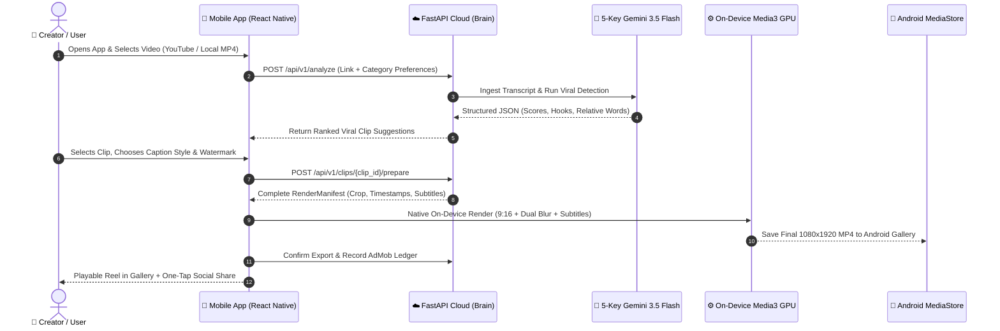
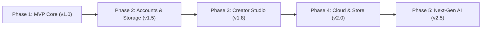

# 🚀 AI Viral Shorts Mobile SaaS — Complete 5-Phase Architecture & Phased Roadmap

> **Target Application:** ClipSnap AI (`ai.pro`)  
> **Core Architecture:** Edge-Cloud Hybrid (FastAPI + 5-Key Gemini 3.5 Flash Brain + On-Device Android Media3 GPU Video Engine)  
> **Target Store:** Google Play Store (Production AAB Release)  

---

## 1. Complete End-to-End User Journey

---

## 2. Master 10-Module Cross-Phase Matrix

Every feature is mapped to a specific phase so we execute step by step without bloat:

| Module | Core Functionality | Phase 1 (MVP v1.0) | Phase 2 (Growth v1.5) | Phase 3 (Studio v1.8) | Phase 4 (Cloud & Launch v2.0) | Phase 5 (Scale AI v2.5) |
| :--- | :--- | :---: | :---: | :---: | :---: | :---: |
| **M1: Auth & Profile** | User identity & accounts | Guest / Device ID | Email + Google Sign-In | JWT Token Refresh | Account Security & Deletion | Creator Team Profiles |
| **M2: Home Dashboard** | Main hub & navigation | Single Home View | 5 Bottom Tabs | Project Cards Preview | Live Storage / Credit Meter | AI Template Suggestions |
| **M3: Video Ingestion** | Ingestion & upload | YouTube URL + Local MP4 | Direct OCI Upload URLs | Chunked / Resumable Upload | MOV & MKV Ingestion | Cloud Drive Import |
| **M4: AI Analysis** | Speech & moment detection | Gemini 3.5 Flash Pool | Category Filters | Custom Virality Weighting | High-Speed Cache Layer | Multi-Language Translation |
| **M5: Clip Selection** | Review suggested clips | Swipeable Carousel | Multi-Select List & Queue | Duration & Score Filters | Custom Manual Clip Trimmer | Auto-Best Clip Picker |
| **M6: Editing Studio** | Layout, captions & styles | 9:16 Dual Blur + 2 Styles | Trim Sliders & Color Picker | 4 Animated Caption Styles | Custom Watermark & Logos | Active Speaker Face Tracking |
| **M7: Render Engine** | High-speed video rendering | Media3 1080x1920 30fps | Export Quality Presets | Custom Bitrate & FPS | Low-End Device Fallback | 4K 60fps & HDR Render |
| **M8: Export History** | Manage completed shorts | Direct Gallery Save | Local SQLite Export Log | In-App Video Player | Re-export Project Settings | Cloud Backup of Timelines |
| **M9: Credits & AdMob** | Monetization & fair usage | 5 Free Credits + Ad Bonus | Google Play Billing Packs | Subscription Tiers | Fraud-Proof Webhook Ledger | Automated Payouts / Invoices |
| **M10: Notifications** | Alerts & background tasks | In-App Modals | Status Drawer | Export Completion Toast | Firebase Push Notifications | Weekly Creator Analytics |

---

## 3. Comprehensive Phased Roadmap & Testing Checkpoints

---

### 🟢 PHASE 1: MVP Core Polish & On-Device Rendering (v1.0)
> **Goal:** Solidify the working core loop so a creator can go from a video link to a fully rendered 9:16 short in their phone gallery with zero crashes.

#### Step 1.1: Multi-Screen Navigation & State Management
* **Implementation:** Clean 4-step wizard navigation:
  - Screen 1: Home Ingestion (YouTube paste / Local MP4)
  - Screen 2: Viral Clip Carousel (Scored cards with attention hook & quote)
  - Screen 3: Style & Caption Editor (Layout toggle, animated style, watermark)
  - Screen 4: Render Progress & Export Complete
* **Target Files:** `mobile/App.tsx`, `mobile/src/screens/HomeScreen.tsx`, `CarouselScreen.tsx`, `EditorScreen.tsx`, `ExportScreen.tsx`
* **Test Checkpoint (`P1-T1`):** Complete flow navigation on Android phone without re-render glitches or state loss.

#### Step 1.2: Android Media3 Native Video Compositor
* **Implementation:** Native Kotlin module leveraging Android Media3 `Transformer`:
  - Background layer: Blurred, zoomed 9:16 vertical crop.
  - Foreground layer: Crisp, centered 16:9 original footage with rounded corners.
  - Subtitle layer: Hardware-accelerated canvas drawing word highlights on exact frames.
* **Target Files:** `mobile/android/app/src/main/java/com/clipsnap/ai/VideoRendererModule.kt`
* **Test Checkpoint (`P1-T2`):** Execute render of a 45s clip. Verify rendering completes in under 30 seconds on phone GPU.

#### Step 1.3: Subtitle Synchronization Engine
* **Implementation:** Relative timestamp mapper ($t_{\text{local}} = t_{\text{spoken}} - t_{\text{start}}$).
  - Style 1 (`Hype Yellow`): Black background box with yellow active word highlight.
  - Style 2 (`Clean Minimal`): Crisp white sans-serif with subtle text drop shadow.
* **Target Files:** `backend/app/services/transcript.py`, `mobile/src/components/SubtitleOverlay.tsx`
* **Test Checkpoint (`P1-T3`):** Play exported video side-by-side with audio to confirm word highlight synchronization within $\pm 100$ms.

#### Step 1.4: Android MediaStore Gallery Export
* **Implementation:** Save rendered MP4 to `DCIM/ClipSnap/` using Android 14+ scoped storage MediaStore API, ensuring immediate visibility in Google Photos / Gallery.
* **Target Files:** `mobile/android/app/src/main/java/com/clipsnap/ai/MediaStoreHelper.kt`
* **Test Checkpoint (`P1-T4`):** Open phone's default Gallery app; confirm exported video is present, playable, and shareable.

#### Step 1.5: AdMob Monetization & Credit Verification
* **Implementation:**
  - Banner ad docked at bottom of Home screen.
  - Rewarded video ad on "Out of Credits" modal granting `+1 Free Clip Credit`.
  - Idempotent backend balance update (`POST /api/v1/credits/claim-ad-reward`).
* **Target Files:** `mobile/src/services/admob.ts`, `backend/app/api/credits.py`
* **Test Checkpoint (`P1-T5`):** Complete 30-second rewarded ad in test mode. Verify credit increments from 5 to 6 in UI and database.

---

### 🟡 PHASE 2: User Accounts, Cloud Storage & Multi-Clip Studio (v1.5)
> **Goal:** Transition from a single-device utility to a cloud-backed SaaS with authenticated users, cloud storage, and project history.

#### Step 2.1: Authentication & User Profiles
* **Implementation:**
  - Email/password signup + Google Sign-In with OAuth2 tokens.
  - User profiles with avatar, creator username, and subscription status.
  - JWT access and refresh token rotation.
* **Target Files:** `backend/app/api/auth.py`, `backend/app/database/models.py`, `mobile/src/screens/AuthScreen.tsx`
* **Test Checkpoint (`P2-T1`):** User registers, logs out, logs in with Google, and sees their saved credits and avatar.

#### Step 2.2: Direct OCI Object Storage Upload Pipeline
* **Implementation:** Never route heavy MP4 uploads through FastAPI:
  1. Mobile app requests upload authorization: `POST /api/v1/media/upload-init`.
  2. FastAPI generates a pre-authenticated OCI Object Storage PUT URL.
  3. Mobile app uploads directly to OCI bucket with progress bar.
  4. Mobile app confirms completion: `POST /api/v1/media/upload-complete`.
* **Target Files:** `backend/app/services/oci_storage.py`, `mobile/src/services/uploader.ts`
* **Test Checkpoint (`P2-T2`):** Upload a 200MB test MP4 directly to OCI without taxing backend CPU/RAM.

#### Step 2.3: User Analysis Category Preferences
* **Implementation:** Let creators choose what moments they want Gemini to focus on:
  - Checkbox selection: `Viral Moments`, `Educational / Tutorials`, `Funny / Memes`, `Motivational`, `Storytelling`, `Podcast Highlights`.
  - Pass selected categories into the Gemini prompt for targeted clip scoring.
* **Target Files:** `backend/app/services/gemini_service.py`, `mobile/src/screens/HomeScreen.tsx`
* **Test Checkpoint (`P2-T3`):** Select "Funny Moments" on a podcast; verify all 3 returned clips feature humorous banter.

#### Step 2.4: Multi-Clip Selection & Batch Queue
* **Implementation:** Multi-select checkbox UI allowing creators to select 1, 2, or all 5 suggested clips for batch editing and rendering.
* **Target Files:** `mobile/src/screens/ClipSelectionScreen.tsx`
* **Test Checkpoint (`P2-T4`):** Select 3 clips at once, customize styles, and verify sequential render pipeline executes without memory crashes.

#### Step 2.5: Bottom Tab Navigation & Project Persistence
* **Implementation:** 5 bottom tabs: `Home`, `Projects`, `Create`, `Exports`, `Profile`. Save project drafts in local SQLite and sync with cloud database.
* **Target Files:** `mobile/src/navigation/TabNavigator.tsx`, `backend/app/database/models.py`
* **Test Checkpoint (`P2-T5`):** Close the app mid-edit, reopen, navigate to "Projects", and resume editing exact clip settings.

---

### 🔵 PHASE 3: Creator Studio & Advanced Video Styling (v1.8)
> **Goal:** Transform the video editor into a professional creative suite with custom branding, advanced typography, and audio controls.

#### Step 3.1: 4 Animated Caption Styles
* **Implementation:**
  1. `Hype Yellow`: Alex Hormozi style with active word pop and black box backdrop.
  2. `Minimalist Clean`: Modern white typography with drop shadow.
  3. `Karaoke Glow`: Progressive word-by-word neon glow.
  4. `Dynamic Pop`: Subtle scale animation (1.0x to 1.15x) on emphasized keywords.
* **Target Files:** `mobile/src/components/SubtitleOverlay.tsx`, `VideoRendererModule.kt`
* **Test Checkpoint (`P3-T1`):** Toggle between all 4 styles in preview and verify on-device render reflects selected animation.

#### Step 3.2: Custom Branding & Watermark Engine
* **Implementation:**
  - Creator logo image upload (.png with transparency).
  - Custom handle/channel name (`@username`).
  - Adjustable position (Top Left, Top Right, Bottom Left, Bottom Right) and opacity slider.
* **Target Files:** `mobile/src/screens/EditorScreen.tsx`, `mobile/src/types/index.ts`
* **Test Checkpoint (`P3-T2`):** Render a clip with transparent PNG logo in top-right corner; confirm crisp alpha blending.

#### Step 3.3: Interactive Frame-by-Frame Video Trimmer
* **Implementation:** Dual-handle scrubber slider allowing the creator to adjust clip start/end boundaries by $\pm 5$ seconds with real-time thumbnail preview.
* **Target Files:** `mobile/src/components/VideoTrimmer.tsx`
* **Test Checkpoint (`P3-T3`):** Adjust start timestamp from 00:12 to 00:15; verify preview and final export cut match exactly.

#### Step 3.4: Audio Controls & Background Music Beds
* **Implementation:**
  - Original audio volume slider (0% to 100%).
  - Royalty-free background music picker (Lo-Fi, Upbeat, Cinematic, Dramatic).
  - Background music volume slider (default: 15% for dialogue clarity) + automated audio fade-in/fade-out.
* **Target Files:** `mobile/src/services/audioManager.ts`, `backend/app/schemas/manifest.py`
* **Test Checkpoint (`P3-T4`):** Export clip with background music; verify voice dialogue remains clearly audible over music.

---

### 🟣 PHASE 4: Cloud VM Deployment & Play Store Launch (v2.0)
> **Goal:** Launch the SaaS publicly on Google Play Store backed by a 24/7 Oracle Cloud production server.

#### Step 4.1: Oracle Cloud VM Production Deployment
* **Implementation:**
  - Open Oracle Cloud Ingress rules for port 8000, 80, and 443 on instance `130.210.123.13`.
  - Configure NGINX reverse proxy with free SSL (Let's Encrypt).
  - Create systemd service `clipsnap-api.service` with auto-restart on reboot.
  - Switch mobile `api.ts` `API_BASE_URL` to `https://api.clipsnap.pro/api/v1`.
* **Target Files:** `backend/systemd/clipsnap-api.service`, `backend/nginx/clipsnap.conf`
* **Test Checkpoint (`P4-T1`):** Make requests to production cloud domain from mobile cellular 5G network; verify response in <2 seconds.

#### Step 4.2: Google Play In-App Billing & Subscriptions
* **Implementation:**
  - Integrate `react-native-iap` for Google Play Billing.
  - Products: `Pro Monthly ($9.99/mo)`, `Pro Annual ($79.99/yr)`, `50 Clip Pack ($4.99)`.
  - Server-side receipt validation with Google Play Developer API.
* **Target Files:** `mobile/src/services/billing.ts`, `backend/app/api/billing.py`
* **Test Checkpoint (`P4-T2`):** Complete test purchase in Google Play License Testing sandbox; verify credits unlock instantly.

#### Step 4.3: Crash Reporting & Performance Telemetry
* **Implementation:**
  - Integrate Sentry / Firebase Crashlytics on mobile app.
  - Integrate Prometheus metrics and Grafana alerts on backend for API latency and key pool health.
* **Target Files:** `mobile/src/utils/logger.ts`, `backend/app/main.py`
* **Test Checkpoint (`P4-T3`):** Trigger a simulated network timeout; verify crash log is received on Sentry dashboard within 60 seconds.

#### Step 4.4: Signed Production Bundle (`.aab`) & Store Listing
* **Implementation:**
  - Generate production signing keystore `clipsnap-release.keystore`.
  - Configure `mobile/android/app/build.gradle` signing keys.
  - Run `./gradlew bundleRelease` to generate optimized Android App Bundle (`app-release.aab`).
  - Complete Google Play Store assets: 512x512 Icon, 1024x500 Feature Graphic, 6.7" Phone Screenshots, Privacy Policy.
* **Target Files:** `mobile/android/app/build.gradle`, `mobile/android/keystore.properties`
* **Test Checkpoint (`P4-T4`):** Upload `.aab` to Google Play Console Internal Testing track; verify 0 warnings on Google Pre-Launch report.

---

### 🟠 PHASE 5: Next-Gen AI Automation (v2.5+)
> **Goal:** High-end AI intelligence that puts the app on par with desktop SaaS tools like Opus Clip and Captions.ai.

#### Step 5.1: Active Speaker Face Tracking & Auto-Reframing
* **Implementation:** On-device Google ML Kit Face Detection running across video keyframes to dynamically pan the 9:16 crop window and keep the active speaker centered.
* **Target Files:** `mobile/android/app/src/main/java/com/clipsnap/ai/FaceTrackerModule.kt`
* **Test Checkpoint (`P5-T1`):** Test on a two-person interview; verify crop smoothly transitions to the speaker who is currently talking.

#### Step 5.2: Multilingual Subtitle Translation
* **Implementation:** Translate transcripts from Marathi/Hindi/Spanish into English or 20+ languages using Gemini Flash, generating synchronized bilingual subtitles.
* **Target Files:** `backend/app/services/gemini_service.py`
* **Test Checkpoint (`P5-T2`):** Ingest Marathi video; select "English Subtitles"; verify translated text syncs with Marathi speech timings.

#### Step 5.3: AI Social Media Kit Generator
* **Implementation:** Gemini generates platform-optimized copy alongside the clip:
  - Viral Title (for YouTube Shorts)
  - Instagram Reels Caption with 15 relevant hashtags
  - TikTok Hook sentence
* **Target Files:** `backend/app/schemas/manifest.py`, `mobile/src/screens/ExportScreen.tsx`
* **Test Checkpoint (`P5-T3`):** Export clip; tap "Copy Social Kit"; verify title, description, and hashtags copy to clipboard in one tap.

#### Step 5.4: Automated B-Roll Overlay
* **Implementation:** AI detects key nouns and concepts in speech and overlays contextual royalty-free stock imagery/videos during key moments to maximize viewer retention.
* **Target Files:** `backend/app/services/broll_service.py`
* **Test Checkpoint (`P5-T4`):** Speaker mentions "money and inflation"; verify contextual stock graphics appear during that 3-second segment.

---

## 4. Execution Rule: How We Build This Together

> [!IMPORTANT]
> **Sequential Gate Enforcement:**  
> We never start a new phase until the current phase passes 100% of its verification tests on your physical Android device. This guarantees we always have a working, buildable, stable release.

> [!TIP]
> **Current Starting Gate: Phase 1 (Step 1.2 & 1.3)**  
> Your device has already verified **Step 1.1** (Carousel & Editor UI) and **Gemini Hook Engine**. Next, we test the **Media3 native video rendering** to save your first 9:16 short to your phone gallery!
