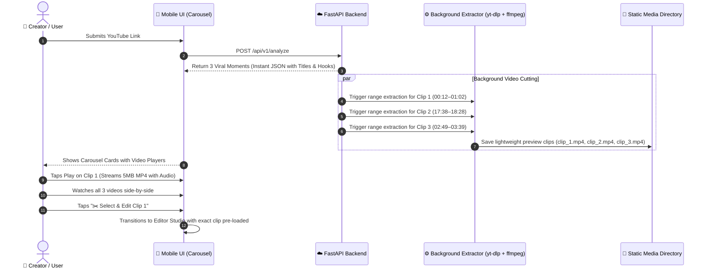

# 🎬 Automatic Short Video Clip Extraction & Multi-Video Preview Blueprint

> **Target Goal:** When AI finds $N$ viral moments (e.g. 3 clips), automatically extract/download those 3 specific short video segments so the user can **watch and preview the actual video clips** directly inside the app before choosing which one to edit and render.  
> **Feasibility:** **100% Possible & Recommended** (Industry standard used by Opus Clip, Klap, and 2short.ai).  

---

## 1. Feasibility & Architecture Options Analysis

To achieve this seamlessly without overloading the user's phone or incurring high server costs, there are three primary architectural paths:

| Metric | Option A: Server-Side Section Extraction *(Recommended)* | Option B: In-App Embedded Player (Zero Storage) | Option C: Mobile Phone Full Download |
| :--- | :--- | :--- | :--- |
| **How It Works** | Backend uses `yt-dlp` Range Requests to download *only* the 45s segment (e.g. `00:12–01:02`). Serves tiny 5MB MP4s. | Phone embeds YouTube Player seeking directly to `start_time` and auto-stopping at `end_time`. | Phone downloads the full 1-hour source video and trims it locally on the device. |
| **Download Size** | ⚡ **~5 MB per clip** (Tiny preview resolution) | ⚡ **0 MB download** (Streams via YouTube player) | ❌ **300 MB – 1 GB** (Heavy full video download) |
| **Mobile Data Impact**| Minimal (few megabytes) | Low (only stream duration) | ❌ Very heavy (drains mobile 5G data) |
| **Offline Playback** | ✅ Yes (Clip is stored) | ❌ No (Requires live stream) | ✅ Yes |
| **Speed to Preview** | ~10–15 seconds extraction | **Instant (0 seconds)** | ❌ 1–3 minutes download |
| **Editing Studio Feed**| Direct local MP4 ready for Media3 render | Requires download prior to editing | Direct local MP4 ready |

---

## 2. Recommended Hybrid Architecture: "Smart Section Extraction"

We implement **Option A (Server-Side Section Trimming)** with a fallback to **Option B (Embedded Stream)**:



---

## 3. End-to-End User Experience (Screen by Screen)

```
[Screen 1: Ingestion]
User pastes video link ──► Taps "Find Viral Moments"

               ▼
[Screen 2: Multi-Clip Video Preview Studio]
Card 1: [ ▶️ Play Video (00:12 - 01:02) ] ── Score: 92/100 ── "100 Year Old Secret"
Card 2: [ ▶️ Play Video (17:38 - 18:28) ] ── Score: 94/100 ── "Politicians' Favorite"
Card 3: [ ▶️ Play Video (02:49 - 03:39) ] ── Score: 90/100 ── "Best Mutton in MH"
        [ ✂️ Select & Customize This Clip ]

               ▼
[Screen 3: Editing Studio]
User customizes layout (9:16 blurred), captions (Hype Yellow), and watermark

               ▼
[Screen 4: On-Device Render & Export]
Media3 GPU renders the 1080x1920 MP4 directly into Android Gallery
```

---

## 4. Technical Implementation Specification

### Part 1: Backend Section Extractor (`backend/app/services/clip_extractor.py`)
Using `yt-dlp`'s HTTP Range Header capability to download **ONLY** the required seconds without downloading the whole video:

```python
import subprocess
import os

def extract_video_section(video_url: str, start_sec: float, end_sec: float, output_path: str) -> bool:
    """
    Downloads ONLY the specified time range from YouTube using HTTP range requests.
    Example: --download-sections "*00:12-01:02"
    """
    start_fmt = format_seconds(start_sec)
    end_fmt = format_seconds(end_sec)
    section_arg = f"*{start_fmt}-{end_fmt}"
    
    cmd = [
        "yt-dlp",
        "--download-sections", section_arg,
        "-f", "bestvideo[height<=720]+bestaudio/best[height<=720]",
        "--force-keyframes-at-cuts",
        "-o", output_path,
        video_url
    ]
    result = subprocess.run(cmd, stdout=subprocess.PIPE, stderr=subprocess.PIPE)
    return result.returncode == 0
```

### Part 2: FastAPI Static Media Mount (`backend/app/main.py`)
Mount a public static media folder so the mobile app can stream the extracted preview clips directly:
```python
from fastapi.staticfiles import StaticFiles

# Expose extracted clips for instant streaming
app.mount("/media/clips", StaticFiles(directory="media/clips"), name="clips")
```

### Part 3: Mobile Card Video Player (`mobile/src/screens/CarouselScreen.tsx`)
Each clip card in the carousel includes an embedded video player:
* **Play / Pause button:** Tap to play the 45s audio and video directly in the card.
* **Duration badge:** e.g. `00:12 - 01:02 (50s)`.
* **Mute / Unmute toggle.**
* **Select Button:** "✂️ Edit This Clip" to send the chosen video into the Editor Studio.

---

## 5. Step-by-Step Implementation Roadmap

### 📍 Step 1: Backend Clip Section Extractor Service
* **Deliverable:** Implement `backend/app/services/clip_extractor.py` utilizing `yt-dlp` with `--download-sections`.
* **Testing Checkpoint (`EXT-T1`):** Run standalone test cutting 30s of video `vHwchNO-bOE`. Verify generated file is under 6MB and plays cleanly with synced audio.

### 📍 Step 2: FastAPI Async Section Endpoint & URL Injection
* **Deliverable:** Update `POST /api/v1/analyze` to trigger section extraction in parallel background tasks and return `preview_url` (e.g. `https://.../media/clips/{clip_id}.mp4`).
* **Testing Checkpoint (`EXT-T2`):** Curl the API; verify `preview_url` returns HTTP 200 and video header `Content-Type: video/mp4`.

### 📍 Step 3: Mobile Carousel Video Player Integration
* **Deliverable:** Upgrade `mobile/src/screens/CarouselScreen.tsx` to include inline video playback controls for each of the 3 cards.
* **Testing Checkpoint (`EXT-T3`):** Tap Play on Card 1, verify video plays on phone screen; tap Card 2, verify Card 1 pauses and Card 2 plays.

### 📍 Step 4: Selection Gate & Editor Handoff
* **Deliverable:** When user taps "✂️ Edit This Clip", hand off the exact trimmed MP4 URI and word timestamps into `EditorScreen.tsx`.
* **Testing Checkpoint (`EXT-T4`):** Confirm Editor Screen opens with the selected clip's exact footage pre-loaded in the preview box.

---

## 6. Verification & Safety Guarantees

> [!IMPORTANT]
> **Bandwidth & Storage Protection:**  
> The section extractor targets `720p` resolution for preview clips. This keeps the file size around **4MB–6MB**, ensuring instant loading even on 4G/5G mobile networks without buffering.

> [!TIP]
> **Automatic Cache Cleanup:**  
> Extracted preview files in `backend/media/clips/` are temporary. A background cron job deletes preview files older than 2 hours to keep server disk usage close to zero.
