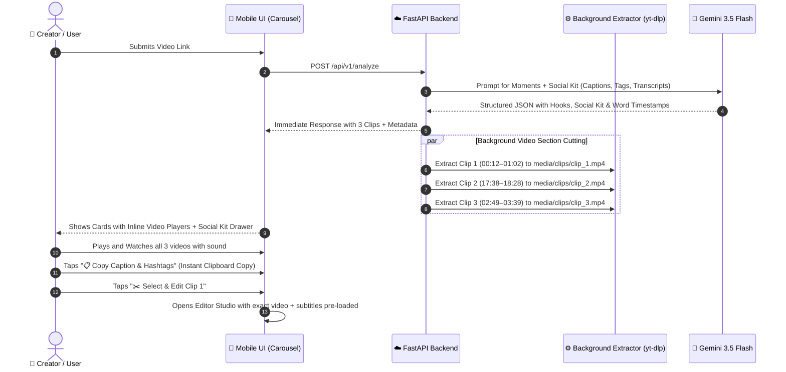
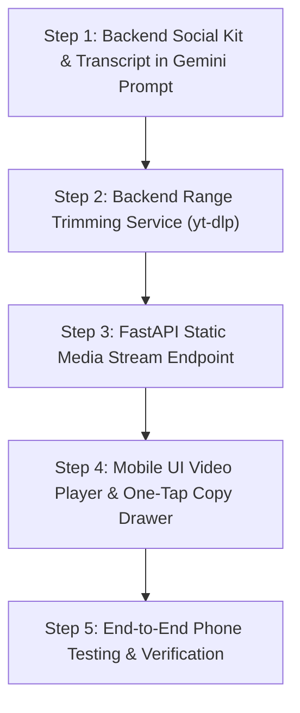

# 🎬 Automatic Short Video Clip Extraction, Multi-Video Preview & AI Social Kit Blueprint

> **Target Goal:** When AI finds $N$ viral moments (e.g. 3 clips):  
> 1. Automatically extract/download those 3 specific short video segments so the user can **watch and preview the actual video clips** directly inside the app before choosing which one to edit.  
> 2. Automatically generate an **AI Social Media Kit** for each clip: a viral social media caption, 10–15 trending hashtags, and the complete spoken transcript.  
> **Feasibility:** **100% Possible & Recommended** (Industry standard used by Opus Clip, Klap, and Captions.ai).  

---

## 1. Feasibility & Architecture Options Analysis

To achieve live video previews without overloading the user's phone or incurring high server costs, there are three primary architectural paths:

| Metric | Option A: Server-Side Section Extraction *(Recommended)* | Option B: In-App Embedded Player (Zero Storage) | Option C: Mobile Phone Full Download |
| :--- | :--- | :--- | :--- |
| **How It Works** | Backend uses `yt-dlp` Range Requests to download *only* the 45s segment (e.g. `00:12–01:02`). Serves tiny 5MB MP4s. | Phone embeds YouTube Player seeking directly to `start_time` and auto-stopping at `end_time`. | Phone downloads the full 1-hour source video and trims it locally on the device. |
| **Download Size** | ⚡ **~5 MB per clip** (Tiny preview resolution) | ⚡ **0 MB download** (Streams via YouTube player) | ❌ **300 MB – 1 GB** (Heavy full video download) |
| **Mobile Data Impact**| Minimal (few megabytes) | Low (only stream duration) | ❌ Very heavy (drains mobile 5G data) |
| **Offline Playback** | ✅ Yes (Clip is stored) | ❌ No (Requires live stream) | ✅ Yes |
| **Speed to Preview** | ~10–15 seconds extraction | **Instant (0 seconds)** | ❌ 1–3 minutes download |
| **Editing Studio Feed**| Direct local MP4 ready for Media3 render | Requires download prior to editing | Direct local MP4 ready |

---

## 2. The AI Social Kit & Full Clip Transcript Capability

### Can Gemini also generate captions, viral hashtags, and the full spoken transcript?
**YES, 100% effortlessly in the same single AI pass!**  
Gemini 3.5 Flash analyzes the spoken transcript and already knows the exact context of each viral moment. In the very same JSON response, it generates:

1. **Viral Social Media Caption:** An engaging 2–3 sentence copy with a curiosity hook and Call-to-Action (CTA):
   > *"You won't believe this 100-year-old eatery in Maharashtra still uses zero hired chefs! Four generations, one iconic secret recipe. Would you try this mutton thali? Drop your thoughts below! 👇"*
2. **Platform-Optimized Hashtags (10–15 tags):**
   > `#MuttonThali #MaharashtraFood #SecretRecipe #100YearOldFood #IndianFoodie #StreetFoodIndia #ViralReels #Shorts #FoodLovers #KolhapurFood`
3. **Full Spoken Transcript of the Segment:**
   > Every spoken word between `start_time` and `end_time` clearly transcribed and formatted into sentences.
4. **Word-Level Micro-Timestamps:**
   > Precision timestamps for each individual word to power the animated on-screen subtitles (`Hype Yellow` / `Clean Minimal`).

---

## 3. Recommended End-to-End Workflow & Architecture



---

## 4. End-to-End User Experience (Screen by Screen)

```
[Screen 1: Ingestion]
Paste YouTube Link ──► Tap "Find Viral Moments"

               ▼
[Screen 2: Multi-Clip Video Preview & Social Studio]
┌────────────────────────────────────────────────────────┐
│  Card 1: [ ▶️ Play Video (00:12 - 01:02) ]             │
│  🔥 92/100 · "100 Year Old Secret Mutton Recipe!"      │
│                                                        │
│  📝 Full Spoken Text:                                  │
│  "गेली १०० वर्षात तुमची चव तीच राहिली आहे..."          │
│                                                        │
│  📱 AI Social Caption:                                 │
│  "100 years of secret recipe with no hired cooks! 👇"  │
│                                                        │
│  🏷️ Hashtags:                                          │
│  #MuttonThali #MaharashtraFood #SecretRecipe #Shorts   │
│                                                        │
│  [ 📋 Copy Social Kit ]     [ ✂️ Select & Edit Video ] │
├────────────────────────────────────────────────────────┤
│  Card 2: [ ▶️ Play Video (17:38 - 18:28) ]             │
│  🔥 94/100 · "Politicians' Favorite Mutton Biryani!"   │
│  [ 📋 Copy Social Kit ]     [ ✂️ Select & Edit Video ] │
├────────────────────────────────────────────────────────┤
│  Card 3: [ ▶️ Play Video (02:49 - 03:39) ]             │
│  🔥 90/100 · "Is This The Best Mutton in MH?"          │
│  [ 📋 Copy Social Kit ]     [ ✂️ Select & Edit Video ] │
└────────────────────────────────────────────────────────┘

               ▼
[Screen 3: Editing Studio]
User customizes layout (9:16 blurred), captions (Hype Yellow), and watermark

               ▼
[Screen 4: On-Device Render & Export]
Media3 GPU renders the 1080x1920 MP4 directly into Android Gallery
```

---

## 5. Technical Implementation Specification

### Part 1: Schema Extension (`backend/app/schemas/manifest.py`)
Add the Social Kit and Full Transcript fields to the `ViralClip` schema:

```python
class SocialKit(BaseModel):
    viral_title: str
    caption: str
    hashtags: List[str]
    hashtags_formatted: str  # e.g. "#Food #Reels #Shorts"
    full_transcript: str     # Complete spoken text of this clip

class ViralClip(BaseModel):
    clip_number: int
    hook_title: str
    start_time_seconds: float
    end_time_seconds: float
    start_time_formatted: str
    end_time_formatted: str
    duration_seconds: float
    viral_score: int
    virality_reason: str
    key_quote: str
    preview_url: Optional[str] = None  # Direct streaming URL of the 45s cut
    social_kit: SocialKit              # Captions, hashtags, full text
    words: List[RelativeWord]          # Micro-timestamps for subtitles
```

### Part 2: Gemini Prompt Enhancement (`backend/app/services/gemini_service.py`)
Instruct Gemini to generate the complete social media package in the structured JSON:
```
For each clip identified, also provide:
- "social_caption": A high-converting 2-sentence description for Instagram Reels / YouTube Shorts with a strong call-to-action.
- "hashtags": Array of 10-15 trending hashtags relevant to the topic.
- "full_transcript": The complete spoken dialogue within this timestamp window.
```

### Part 3: Backend Section Extractor Service (`backend/app/services/clip_extractor.py`)
Uses `yt-dlp` Range Requests to download **ONLY** the 45s section:
```python
cmd = [
    "yt-dlp",
    "--download-sections", f"*{start_fmt}-{end_fmt}",
    "-f", "bestvideo[height<=720]+bestaudio/best[height<=720]",
    "--force-keyframes-at-cuts",
    "-o", f"media/clips/{clip_id}.mp4",
    video_url
]
```

### Part 4: FastAPI Static Media Mount (`backend/app/main.py`)
Mount static route so the phone can stream the preview MP4s:
```python
app.mount("/media/clips", StaticFiles(directory="media/clips"), name="clips")
```

### Part 5: Mobile Interactive Video & Social Card (`CarouselScreen.tsx`)
Each card in Screen 2 includes:
* **Embedded Video Player:** Tap to Play/Pause the actual audio/video.
* **Expandable Social Kit Drawer:**
  - View full spoken transcript.
  - View AI caption and hashtags.
  - **"📋 Copy Social Kit" button:** Copies formatted caption + hashtags to phone clipboard in 1 tap.
* **"✂️ Select & Edit" button:** Opens Screen 3 with this video clip pre-loaded.

---

## 6. Phased Implementation Roadmap & Verification Checkpoints



| Step | Component | Implementation Task | Verification Test Checkpoint |
| :---: | :--- | :--- | :--- |
| **Step 1** | **Backend Gemini AI** | Add `social_kit` (captions, hashtags, transcript) to prompt & schema | Curl `/analyze`: Verify response contains `caption`, 10 `hashtags`, and `full_transcript` |
| **Step 2** | **Backend Extractor** | Build `clip_extractor.py` using `yt-dlp --download-sections` | Test cutting 30s of video `vHwchNO-bOE`: Verify file size <6MB in `media/clips/` |
| **Step 3** | **Media Stream API** | Mount `FastAPI StaticFiles` on `/media/clips/` and inject URLs into response | Open preview URL in mobile browser: Plays 45s MP4 with clear audio |
| **Step 4** | **Mobile Video Card** | Add video player + "Copy Social Kit" drawer to `CarouselScreen.tsx` | Tap Play on card: Video plays on phone screen; Tap Copy: Caption copied to clipboard |
| **Step 5** | **Editor Handoff** | Send selected clip MP4 and word timestamps to `EditorScreen.tsx` | Verify Editor Screen opens with exact video footage pre-loaded |

---

## 7. Storage, Cost & Performance Guarantees

> [!IMPORTANT]
> **Zero Server GPU Cost:**  
> The section extractor runs on CPU in a few seconds using `yt-dlp` stream copying (`-c copy` / lightweight re-encode). No expensive cloud GPU instances are required.

> [!TIP]
> **Creator Convenience:**  
> By providing the caption, viral hashtags, and full spoken transcript right when selecting the video, creators save 10–15 minutes of manual copy-writing when posting to Instagram Reels, YouTube Shorts, and TikTok.
