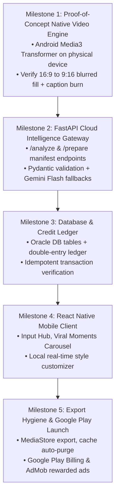

# 🚀 Master Production Architecture Report: AI Viral Shorts SaaS
## Hybrid Cloud-Edge Architecture (Cloud Intelligence + Android Media3 On-Device Video Engine)

---

## 1. Executive Summary & Core Architectural Paradigm

This document establishes the official production architecture for the **AI Viral Shorts SaaS**.

### The Core Architectural Shift:
> **"Let the Cloud handle Intelligence and Coordination. Let the Smartphone handle Video Rendering."**

By decoupling heavy video composition from our backend, the application runs on a **Hybrid Cloud-Edge Architecture**:
- **Cloud Control Plane (Oracle Cloud Infrastructure):** Acts as the high-speed intelligence and coordination hub. It handles subtitle acquisition, Google Gemini AI prompt orchestration, Pydantic response validation, credit transaction ledgers, and secure media delivery.
- **Client Rendering Plane (User's Smartphone):** Acts as the dedicated GPU/MediaCodec video production studio. It performs 9:16 vertical composition, dual-layer blurred background generation, word-level animated caption rendering, watermark compositing, and direct Android MediaStore gallery export.

```
┌────────────────────────────────────────────────────────────────────────┐
│                   CLOUD CONTROL PLANE (Oracle Cloud)                   │
│                                                                        │
│   FastAPI Gateway  ◄──►  Gemini 3.5 Flash  ◄──►  OCI Object Storage   │
│   (Auth & Credits)       (Viral Clip AI)         (Pre-Auth URLs)       │
└───────────────────────────────────┬────────────────────────────────────┘
                                    │ HTTPS (Metadata + ~15MB Stream)
                                    ▼
┌────────────────────────────────────────────────────────────────────────┐
│                 CLIENT RENDERING PLANE (User Smartphone)               │
│                                                                        │
│   React Native UI  ◄──►  Native Bridge  ◄──►  Android Media3 Engine    │
│   (Preview/Styles)       (TypeScript)         (GPU / MediaCodec Export)│
└────────────────────────────────────────────────────────────────────────┘
```

---

## 2. Realistic Scalability & Resource Analysis

The shift to on-device rendering eliminates the server CPU/RAM crash bottleneck, but a production system must account for all real-world constraints:

| System Component | Old Model (Server Render) | New Hybrid Edge Model | Production Bottleneck Management |
|---|---|---|---|
| **Server CPU** | 100% pegged per encode (45-90s) | **< 2% CPU** (~1.2s per request) | Solved: Server never runs heavy FFmpeg encodes. |
| **Server RAM** | 800 MB – 1.8 GB per job (OOM crash) | **~60 MB constant** (FastAPI) | Solved: Fits comfortably in 1 GB Oracle VM. |
| **Max Concurrent Encodes** | 1 to 2 concurrent users | **Unlimited** (Client hardware) | Scaled automatically with user device fleet. |
| **AI Intelligence Quota** | Gemini Cloud API limits | Gemini Cloud API limits | **Managed:** Rate-limiting + exponential backoff + caching transcripts. |
| **Network Egress** | Heavy (Server streams final 1080p) | Moderate (Only slices ~15 MB) | **Managed:** 10 TB/month free OCI egress allowance. |
| **Client Device Fleet** | Irrelevant (Cloud did it) | **High variance** (2 GB to 12 GB RAM) | **Managed:** Adaptive resolution (720p vs 1080p) & thermal backoff. |

---

## 3. End-to-End User Journey & Production Sequence

```mermaid
sequenceDiagram
    autonumber
    actor User as Creator (App)
    participant Phone as React Native App
    participant Engine as Android Media3 Engine
    participant Server as FastAPI (Oracle Cloud)
    participant Gemini as Google Gemini Flash
    participant OCI as OCI Object Storage

    User->>Phone: Pastes Video URL or Uploads MP4
    Phone->>Server: POST /api/v1/analyze { source_type, payload }
    
    rect rgb(30, 45, 65)
        Note over Server,Gemini: Cloud Intelligence Pipeline
        Server->>Server: Extract subtitles or audio transcript
        Server->>Gemini: Prompt with transcript + Virality Criteria
        Gemini-->>Server: Structured JSON (Hooks, Scores, Relative Times)
        Server->>Server: Pydantic Validation (Overlap, Duration, Range Checks)
    end
    
    Server-->>Phone: Return 6 Validated Viral Cards
    Phone->>User: Displays Interactive Carousel (Scores: 96, 95, 94...)
    
    User->>Phone: Selects Favorite Clip (e.g. Clip #1)
    Phone->>Server: POST /api/v1/clips/{clip_id}/prepare
    Server->>OCI: Generate short-lived Pre-Authenticated URL
    Server-->>Phone: Return Media Manifest (Stream URL + Word Timestamps)
    
    Phone->>Phone: Downloads source segment to App Private Cache
    Phone->>User: Shows Real-Time Style & Caption Preview
    User->>Phone: Customizes Template, Font Color, and @CreatorTag
    User->>Phone: Taps "Generate Short"
    
    rect rgb(40, 60, 40)
        Note over Phone,Engine: On-Device Video Engine Pipeline
        Phone->>Engine: Send Render Manifest (Trim, Layout, Captions, Tag)
        Engine->>Engine: Check Device Profile (Adaptive 720p/1080p)
        Engine->>Engine: GPU Dual-Layer Composition (Blurred BG + Sharp FG)
        Engine->>Engine: Overlay Word-Level Animated Subtitles & Watermark
        Engine->>Engine: Hardware MediaCodec H.264 / AAC Encoding
        Engine-->>Phone: Progress Callbacks (25%... 70%... 100%)
    end
    
    Engine->>Phone: Verify exported MP4 integrity
    Phone->>Phone: Save to Android MediaStore Gallery
    Phone->>Phone: Auto-purge temporary source slice from cache
    Phone->>Server: POST /api/v1/device-exports/confirm (Finalize Credit)
    Phone-->>User: Fullscreen Player with 1-Tap "Share to Shorts/Reels"
```



---

## 4. Multi-Mode Media Input Architecture

To maintain 100% operational reliability, legal compliance, and avoid YouTube stream-throttling blocks, the system implements **Three Ingestion Modes**:

### Mode A: Direct MP4 Upload (MVP Primary)
- **Workflow:** User selects any video directly from their phone gallery or camera.
- **Advantages:** 100% reliable, zero stream restrictions, no 403 Forbidden errors.
- **Process:** Video uploaded via pre-authenticated URL to OCI Object Storage $\rightarrow$ Audio extracted $\rightarrow$ Gemini analyzes transcript $\rightarrow$ Client phone downloads authorized source slice for editing.

### Mode B: YouTube Link Analysis
- **Workflow:** User provides a public YouTube URL.
- **Process:** Backend extracts subtitles and metadata via official or permitted APIs $\rightarrow$ Gemini selects viral moments $\rightarrow$ For rendering, segment is fetched via client-side proxy or authorized download stream.

### Mode C: Creator Cloud Storage (V2 Enterprise)
- **Workflow:** Google Drive / Dropbox integration for podcast studios.
- **Process:** Direct streaming from creator's cloud account using OAuth tokens.

---

## 5. Mobile Video Engine Specification: Android Media3 Transformer

### Why Android Media3 Transformer over Deprecated FFmpegKit:
- **Official Google Android Ecosystem:** Actively maintained as the successor to ExoPlayer and MediaCodec wrappers.
- **Direct Hardware Acceleration:** Bypasses software emulation, using Android's native `MediaCodec` and OpenGL ES shader pipelines.
- **Zero Heavy Binary Overhead:** Drastically smaller APK footprint compared to compiling monolithic native FFmpeg binaries.
- **Thermal & Memory Efficiency:** Uses Android system-level buffer recycling, preventing Out-Of-Memory exceptions on 2 GB – 4 GB RAM devices.

### On-Device Processing Pipeline:

```
[Input Video Source]
        │
        ├──>[OpenGL Shader: Background Layer]
        │       └──> Aspect Ratio Expand ──> Center Crop 1080x1920 ──> Gaussian Blur Shader
        │
        ├──>[OpenGL Shader: Foreground Layer]
        │       └──> Aspect Ratio Decrease ──> High-Fidelity Center Positioning
        │
        └──>[Vector Canvas: Typography & Watermark]
                ├──> Word-by-Word Synchronized Animated Text (Relative Timestamps)
                └──> User Watermark Pill (@creator_handle)
                        │
                        ▼
            [Android Media3 Composition Pipeline]
                        │
                        ▼
            [Hardware MediaCodec Encoder (H.264 / AAC)]
                        │
                        ▼
            [Verified MP4 Export in MediaStore Gallery]
```

### Adaptive Quality Profiles (Device-Aware Rendering):
Before initiating render, the engine probes device capabilities and dynamically assigns an export profile:

```
                  ┌───────────────────────────────┐
                  │ Runtime Device Capability Test │
                  └──────────────┬────────────────┘
                                 │
         ┌───────────────────────┼───────────────────────┐
         ▼                       ▼                       ▼
  [Low-End Profile]      [Standard Profile]       [Flagship Profile]
  • RAM < 4 GB           • RAM 4 GB - 8 GB        • RAM > 8 GB / High GPU
  • 720x1280 @ 30 FPS    • 1080x1920 @ 30 FPS     • 1080x1920 @ 60 FPS
  • Simplified Blur      • Full Gaussian Blur     • Multi-pass Glare & Blur
  • Fast Single-Pass     • Standard Bitrate       • High-Bitrate H.264
```

---

## 6. Word-Level Animated Caption Engine

Standard YouTube captions provide phrase-level timestamps (3–5 seconds per block). For modern, high-engagement viral Shorts, the app implements **Micro-Timestamp Alignment**:

### 6.1 Relative Time Normalization
Caption timestamps are strictly normalized relative to the clip start point:
$$t_{\text{local}} = t_{\text{spoken}} - t_{\text{clip\_start}}$$

*Example:* If a 45-second clip starts at $05:12$ ($312\text{s}$) in the source video, a word spoken at $314.5\text{s}$ has a local timestamp of:
$$314.5\text{s} - 312.0\text{s} = 2.5\text{s}$$

### 6.2 Caption Data Schema (Manifest Output)
```json
{
  "clip_id": "clip_baramati_fish_01",
  "caption_style": "hype_yellow",
  "words": [
    { "word": "या", "start": 0.12, "end": 0.35, "highlight": true },
    { "word": "हॉटेलमध्ये", "start": 0.35, "end": 0.85, "highlight": true },
    { "word": "स्वतः", "start": 0.85, "end": 1.15, "highlight": true },
    { "word": "अजितदादा", "start": 1.15, "end": 1.70, "highlight": true }
  ]
}
```

### 6.3 Caption Styling Presets
1. **Hype Yellow (Hormozi Style):** 3 words per line, uppercase bold, spoken word lights up in electric yellow (`#FFE600`) with a dark drop shadow.
2. **Minimalist Clean:** Pure white typography with subtle letter-spacing and dark frosted-glass backing.
3. **Karaoke Glow:** Smooth gradient fill expanding across words as sound amplitude peaks.

---

## 7. Storage Lifecycle & Crash Recovery Architecture

To protect user storage and prevent corrupted partial files, the mobile client implements a **Strict Transactional Storage Lifecycle**:

```
[Phase 1: Download]
   └──> Download to: /data/user/0/com.aipro/cache/source/temp_slice.mp4

[Phase 2: Pre-Flight Check]
   └──> Verify free disk space > 3x output size (min 200 MB free)
   └──> Validate MP4 container headers and duration

[Phase 3: Render]
   └──> Media3 writes to: /data/user/0/com.aipro/cache/render_temp/staging.mp4

[Phase 4: Post-Flight Verification]
   └──> Verify staging.mp4 is non-empty, playable, and duration matches target (±0.5s)

[Phase 5: Commit to MediaStore]
   └──> Android MediaStore API inserts video into DCIM/AI_Pro_Shorts/

[Phase 6: Safe Cleanup]
   └──> ONLY after MediaStore returns successful URI:
        • Delete temp_slice.mp4
        • Delete staging.mp4
```

### Crash Recovery Mechanism:
- On application launch, a **Startup Hygiene Routine** scans `/cache/source/` and `/cache/render_temp/`.
- Any orphaned file older than 1 hour is automatically purged.
- If a render was interrupted mid-flight, the app prompts: *"Your previous Short render was interrupted. Would you like to resume with one tap?"*

---

## 8. Database Architecture & Credit Ledger

To avoid concurrency issues, duplicate charges, or lost credits, the database utilizes a **Double-Entry Ledger Pattern** with idempotency keys:

### Relational Schema (Oracle Database)

```sql
-- 1. Core Users Table
CREATE TABLE users (
    user_id VARCHAR2(36) PRIMARY KEY,
    email VARCHAR2(255) UNIQUE NOT NULL,
    created_at TIMESTAMP WITH TIME ZONE DEFAULT CURRENT_TIMESTAMP
);

-- 2. User Credit Balance (Cache Table)
CREATE TABLE user_credits (
    user_id VARCHAR2(36) PRIMARY KEY REFERENCES users(user_id),
    balance NUMBER(10) DEFAULT 5 NOT NULL,
    updated_at TIMESTAMP WITH TIME ZONE DEFAULT CURRENT_TIMESTAMP
);

-- 3. Immutable Credit Transaction Ledger
CREATE TABLE credit_transactions (
    transaction_id VARCHAR2(36) PRIMARY KEY,
    user_id VARCHAR2(36) NOT NULL REFERENCES users(user_id),
    amount NUMBER(5) NOT NULL, -- (+5 for purchase, -1 for export, +1 for refund)
    reason VARCHAR2(50) NOT NULL, -- 'SIGNUP_BONUS', 'EXPORT_CLIP', 'REWARD_AD', 'RENDER_FAILED_REFUND'
    idempotency_key VARCHAR2(64) UNIQUE NOT NULL,
    created_at TIMESTAMP WITH TIME ZONE DEFAULT CURRENT_TIMESTAMP
);

-- 4. Media Sources (Uploaded or Linked)
CREATE TABLE media_sources (
    source_id VARCHAR2(36) PRIMARY KEY,
    user_id VARCHAR2(36) NOT NULL REFERENCES users(user_id),
    source_type VARCHAR2(20) NOT NULL, -- 'DIRECT_UPLOAD', 'YOUTUBE_URL'
    storage_key VARCHAR2(500),
    duration_seconds NUMBER(10, 2),
    status VARCHAR2(20) NOT NULL -- 'PENDING', 'ANALYZED', 'ERROR'
);

-- 5. AI Detected Viral Clips
CREATE TABLE clips (
    clip_id VARCHAR2(36) PRIMARY KEY,
    source_id VARCHAR2(36) NOT NULL REFERENCES media_sources(source_id),
    start_time_seconds NUMBER(10, 2) NOT NULL,
    end_time_seconds NUMBER(10, 2) NOT NULL,
    viral_score NUMBER(3) NOT NULL,
    hook_title VARCHAR2(300) NOT NULL,
    key_quote VARCHAR2(500),
    virality_reason VARCHAR2(1000)
);

-- 6. Device Exports Tracking (Tracks Mobile Hardware Renders)
CREATE TABLE device_exports (
    export_id VARCHAR2(36) PRIMARY KEY,
    user_id VARCHAR2(36) NOT NULL REFERENCES users(user_id),
    clip_id VARCHAR2(36) NOT NULL REFERENCES clips(clip_id),
    device_model VARCHAR2(100),
    profile_used VARCHAR2(20), -- 'LOW_720P', 'STD_1080P', 'HIGH_1080P60'
    render_status VARCHAR2(20) NOT NULL, -- 'STARTED', 'COMPLETED', 'FAILED'
    created_at TIMESTAMP WITH TIME ZONE DEFAULT CURRENT_TIMESTAMP
);
```

---

## 9. Production Codebase Organization

The project structure is organized to cleanly separate Cloud Intelligence, React Native UI, and Native Android Video Engines:

```
AI-VIRAL-SHORTS/
│
├── backend/                       # Python FastAPI Backend (Oracle Cloud VM)
│   ├── app/
│   │   ├── main.py                # FastAPI Application Entrypoint
│   │   ├── config.py              # Environment & Gemini Configuration
│   │   ├── api/                   # REST Endpoints
│   │   │   ├── analyze.py         # Subtitle Extraction & Gemini AI Dispatch
│   │   │   ├── media.py           # Pre-authenticated Upload & Slicing Delivery
│   │   │   ├── credits.py         # Credit Ledger & AdMob Claim Endpoints
│   │   │   └── exports.py         # Device Export Confirmations
│   │   ├── services/
│   │   │   ├── gemini_service.py  # Gemini Flash Structured JSON Engine
│   │   │   ├── validator.py       # Pydantic Timestamp & Overlap Verifiers
│   │   │   ├── transcript.py      # YouTube Transcript & Audio Aligners
│   │   │   └── oci_storage.py     # Oracle Object Storage S3-compatible Client
│   │   └── database/
│   │       ├── models.py          # SQLAlchemy Models
│   │       └── session.py         # Oracle DB Connection Pooling
│   ├── viral_detector.py          # Standalone Verification Script
│   └── requirements.txt           # Python Dependencies
│
├── mobile/                        # React Native + Expo Application
│   ├── src/
│   │   ├── screens/
│   │   │   ├── HomeScreen.tsx     # Link Input & Video Upload Hub
│   │   │   ├── CarouselScreen.tsx # Top 6 Viral Moments Cards
│   │   │   ├── EditorScreen.tsx   # Template, Caption & Tag Customizer
│   │   │   └── ExportScreen.tsx   # Native Render Progress & Share Hub
│   │   ├── components/            # Reusable UI Cards, Sliders, Badges
│   │   ├── services/              # API Client (Axios + JWT interceptor)
│   │   └── video-engine/          # Native Bridge Layer
│   │       ├── types.ts           # RenderManifest & DeviceProfile Interfaces
│   │       ├── VideoRenderer.ts   # Native Module Invocation Bridge
│   │       └── StorageManager.ts  # MediaStore & Cache Hygiene Utilities
│   ├── android/                   # Native Android Layer
│   │   └── app/src/main/java/com/aipro/
│   │       ├── VideoRendererModule.kt  # Media3 Transformer Engine
│   │       └── shaders/                # OpenGL ES Dual-Layer Blur Shaders
│   ├── app.json                   # Expo Configuration
│   └── package.json               # JavaScript Dependencies
│
├── shared/                        # Shared Schemas & Types
│   ├── schemas/manifest.json      # Single Source of Truth for RenderManifest
│   └── types/api.d.ts             # Shared API Response Types
│
└── docs/                          # Architectural & Operational Documentation
    ├── ON_DEVICE_SHORTS_ARCHITECTURE_REPORT.md
    └── PROJECT_MASTER_DOCUMENTATION.md
```

---

## 10. Step-by-Step Implementation Roadmap



### The Recommended First Milestone:
> **Milestone 01: On-Device Video Rendering Proof-of-Concept**
> Before building full UI screens, take a single 30-second landscape MP4 on your test Android device and run the native Media3 Transformer pipeline to produce the 1080x1920 blurred-fill reel with captions. Once that executes cleanly, the most technically demanding part of the entire SaaS is guaranteed.
